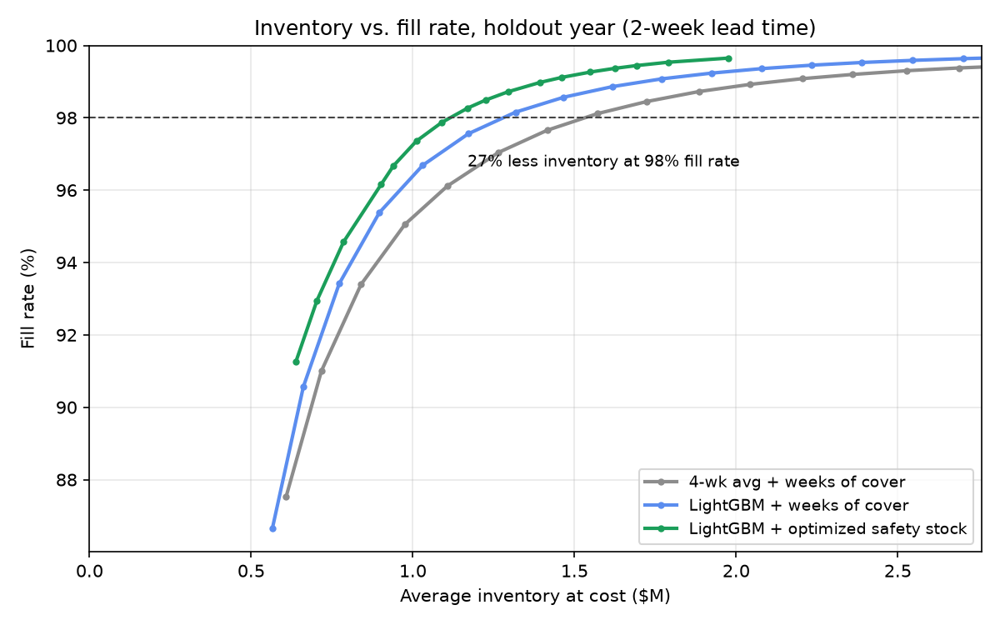

# Inventory Planning on Real Walmart Data

I built this project to answer a question every supply chain planner deals with: how much inventory do you actually need to hit a service target, and how much of that number comes down to forecasting versus how you set safety stock?

Using five years of real Walmart sales and cost figures from Walmart's own 10-K, I forecast weekly demand for 8,044 item-states, sized safety stock from each item's real forecast errors, and simulated a full year of replenishment against a planner-style baseline.

**At a 98% fill rate, the optimized policy holds 27% less inventory than the baseline.** About 61% of those savings come from better forecasting and 39% from smarter safety stock, and the result holds across lead times from 1 to 4 weeks.



## Results

Average inventory needed to hit each fill rate over the holdout year (May 2015 to May 2016), with a 2-week lead time:

| Fill rate | Baseline | LightGBM + weeks of cover | LightGBM + optimized safety stock | Savings |
|---|---|---|---|---|
| 95% | $971K | $872K | $817K | 15.8% |
| 97% | $1.26M | $1.08M | $974K | 22.6% |
| 98% | $1.53M | $1.28M | $1.12M | 27.2% |
| 99% | $2.12M | $1.72M | $1.40M | 33.8% |

What stood out to me:

- **Savings grow as service tightens.** Every extra point of fill rate costs more safety stock, so a better forecast is worth more the higher the target.
- **Nothing got sacrificed in the long tail.** At 98% overall, every ABC class and demand pattern holds less inventory, slow and erratic items actually got slightly better service, and the share of item-states below 90% fill dropped from 6.7% to 6.2%.
- **The result doesn't hinge on the lead time assumption.** Savings range from 26.6% at a 1-week lead time to 29.3% at 4 weeks.
- **The simple baseline was the one to beat.** A 4-week moving average beat Croston's method, the textbook approach for intermittent demand, even on intermittent items. LightGBM cut error 13% below the moving average (19.6% vs. 22.5% WMAPE on 3-week totals) and beat it in every segment.

Full tables are in [`reports/`](reports/): [policy results](reports/policy_results.md), [forecast accuracy](reports/forecast_accuracy.md), and [segmentation](reports/segmentation_summary.md).

## Data

- **Demand and prices:** the [M5 dataset](https://www.kaggle.com/competitions/m5-forecasting-accuracy), which is actual Walmart unit sales for 3,049 products across 10 stores in California, Texas, and Wisconsin, recorded daily from January 2011 to May 2016, with real weekly shelf prices and calendar events.
- **Costs and inventory levels:** Walmart's 10-K filings for fiscal 2011 through 2017, pulled from SEC's XBRL API.

## Assumptions

Public data doesn't include SKU-level costs or lead times, so every assumption is either sourced or stress-tested.

| Parameter | Value | Source |
|---|---|---|
| Demand and shelf prices | Actual | M5 (Walmart) |
| Unit cost | 75.1% to 75.7% of shelf price, by fiscal year | Walmart 10-K: cost of sales / net sales, checked against Walmart's reported gross margin every year |
| Lead time | 2 weeks (tested 1 to 4) | Assumption; no public source exists at the SKU level |
| Review period | Weekly | Standard for retail replenishment |
| Holding cost | 25% of unit cost per year (tested 15% to 35%) | Commonly cited industry range; it converts inventory to dollars and doesn't change the policy comparison |
| Stockouts | Lost sales | Standard retail assumption |
| Sanity check | Walmart carried about 6.5 weeks of inventory in FY2016 | Walmart 10-K |

## How it works

The pipeline runs in five steps, and each one checks its own output before saving anything.

1. **Cost calibration** (`walmart_10k_calibration.py`). Pulls Walmart's net sales, cost of sales, and inventory from SEC's API and derives a cost ratio and days of inventory for each fiscal year. If the computed gross margin doesn't match what Walmart reported, nothing gets saved.
2. **Data pipeline** (`load_m5.py`). Reshapes 59 million item-store-days with DuckDB, attaches prices and unit costs, and writes Parquet, with 14 automated checks in about 30 seconds. It keeps only days when an item was actually on the shelf: 21% of the raw rows were pre-launch zeros, and dropping them lost zero units of demand.
3. **Segmentation** (`segment.py`). Rolls up to weekly demand and classifies each item-state by ABC (dollar volume), XYZ (demand variability), and Syntetos-Boylan demand pattern (smooth, erratic, intermittent, lumpy). 8,044 of 9,147 item-states made it into the model, covering 93.3% of dollar volume.
4. **Forecasting** (`forecast.py`). One global LightGBM model with a Tweedie objective forecasts 1 to 5 weeks ahead, retrained every 13 weeks in a walk-forward backtest. The baselines are 4- and 13-week moving averages and Croston's method with the Syntetos-Boylan correction.
5. **Policy simulation** (`simulate.py`). Runs a weekly order-up-to policy through the holdout year for three policies, sweeps each one across its settings to trace the inventory vs. fill-rate curve, and compares them at matched fill rate.

## Design decisions

- **No look-ahead.** The last 52 weeks are a holdout that nothing touches until the final test. Item classification and safety stock both use only the year before it, and every forecasting model trains only on data it would have had at the time.
- **A fair baseline.** Walmart's 10-K implies about 6.5 weeks of inventory, but that figure covers shelf displays, backroom stock, and goods in transit. Using it as the baseline would inflate the savings, so the baseline is a planner's rule (4-week average plus a uniform number of weeks of cover) simulated under exactly the same conditions.
- **Separating the two sources of savings.** The middle policy uses the LightGBM forecast with the same weeks-of-cover rule, which isolates what the forecast alone is worth. Everything beyond that comes from safety stock.
- **Optimizing safety stock for the right target.** Giving every item the same chance of not stocking out is inefficient, because fill rate counts units and a uniform target overspends on small, erratic items. Minimizing inventory dollars for a given fill rate instead gives each item the rule $F(z_i) = 1 - c_i/\lambda$: an item's chance of not stocking out falls as its unit cost $c_i$ rises, since fill rate is cheapest to buy on cheap items. An 80% floor keeps any single item from being starved.
- **Safety stock from real errors.** Each item's buffer comes from its actual forecast errors over the lead time, pooled within its demand pattern, so intermittent items get their own skewed error distribution instead of a normal curve.
- **Weekly planning.** Across the modeled item-states, 34.5% of days have zero sales but only 10.1% of weeks do.

## Limitations and next steps

- **Costs are company-wide.** Walmart doesn't report margins by category, so every item uses the same cost ratio. Category-level margins would sharpen the dollar figures.
- **Lead times are assumed.** No public source exists at the SKU level, which is why the results are stress-tested from 1 to 4 weeks.
- **Real ordering constraints aren't modeled.** Case packs, minimum order quantities, and shelf capacity would add inventory to both policies.
- **Each state is treated as one distribution center.** A two-level model (DC to store) is the natural next step.
- **Item-states whose store count changed are excluded** (4.2% of dollar volume). Modeling demand per store would bring them back in.
- **Ten stores.** The percentages are the headline. The dollar figures are small because M5 covers only 10 stores.

## Reproduce

Requires Python 3.11+ and, on a Mac, OpenMP for LightGBM.

```bash
brew install libomp
python3 -m venv .venv && source .venv/bin/activate
pip install -r requirements.txt
export SEC_USER_AGENT="Your Name your.email@example.com"
```

Download `calendar.csv`, `sell_prices.csv`, and `sales_train_evaluation.csv` from the [M5 competition](https://www.kaggle.com/competitions/m5-forecasting-accuracy/data) into `data/raw/m5/`, then run the steps in order:

```bash
python walmart_10k_calibration.py
python load_m5.py
python segment.py
python forecast.py
python simulate.py
```

The full pipeline runs in a few minutes on a laptop.

## Repo structure

```
├── walmart_10k_calibration.py   # 1. cost and inventory calibration from the 10-K
├── load_m5.py                   # 2. M5 data pipeline with unit costs
├── segment.py                   # 3. weekly rollup and ABC/XYZ/demand-pattern segmentation
├── forecast.py                  # 4. walk-forward LightGBM forecasts and baselines
├── simulate.py                  # 5. inventory policy simulation
├── reports/                     # generated tables and the frontier chart
├── requirements.txt
└── data/                        # raw and processed data (not committed)
```
