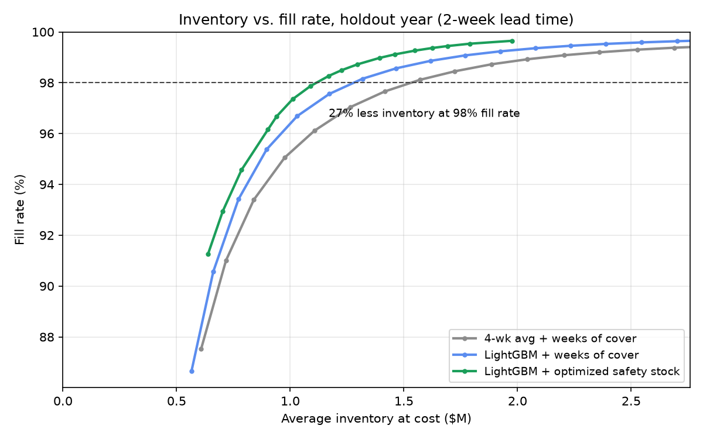

# Inventory policy results (holdout year)

- Weekly order-up-to policy, 2-week base lead time, lost sales, 8,044 item-states
- Policies compared at matched fill rate; savings split into better forecasting and better safety stock
- Safety stock sized only from forecast errors in the year before the holdout, then allocated to minimize inventory dollars at each fill rate, with an 80% minimum per-item service floor

## Average inventory at matched fill rate

| Fill rate | Baseline | LightGBM + cover | LightGBM + safety stock | Total savings | From forecast | From safety stock |
|---|---|---|---|---|---|---|
| 95% | $971K | $872K | $817K | 15.8% | 10.2% | 5.7% |
| 97% | $1.26M | $1.08M | $974K | 22.6% | 14.0% | 8.5% |
| 98% | $1.53M | $1.28M | $1.12M | 27.2% | 16.5% | 10.7% |
| 99% | $2.12M | $1.72M | $1.40M | 33.8% | 19.1% | 14.7% |

## By segment at 98% overall fill rate

| Segment | Baseline inventory | Baseline fill | Policy inventory | Policy fill | Inventory change |
|---|---|---|---|---|---|
| ABC A | $1.21M | 98.3% | $857K | 98.2% | 29.4% |
| ABC B | $227K | 97.7% | $180K | 97.7% | 20.9% |
| ABC C | $91K | 95.7% | $78K | 96.2% | 13.9% |
| smooth | $1.26M | 98.5% | $896K | 98.3% | 29.0% |
| erratic | $57K | 94.4% | $52K | 96.8% | 8.5% |
| intermittent | $183K | 95.0% | $144K | 95.8% | 21.2% |
| lumpy | $31K | 93.1% | $23K | 93.6% | 24.4% |

## Annual holding cost at 98% fill rate

| Holding rate | Baseline | Policy | Savings |
|---|---|---|---|
| 15% | $230K | $167K | $62K |
| 25% | $383K | $279K | $104K |
| 35% | $536K | $390K | $146K |

## Lead-time stress test at 98% fill rate

| Lead time | Baseline | Policy | Savings | Weeks of supply (baseline vs policy) |
|---|---|---|---|---|
| 1 week | $1.13M | $826K | 26.6% | 2.0 vs 1.5 |
| 2 weeks | $1.53M | $1.12M | 27.2% | 2.7 vs 2.0 |
| 3 weeks | $1.95M | $1.41M | 27.8% | 3.4 vs 2.5 |
| 4 weeks | $2.46M | $1.74M | 29.3% | 4.3 vs 3.1 |

## Long-tail service

Item-states below 90% fill at 98% overall: baseline 6.7%, policy 6.2%

## Sanity check

Simulated weeks of supply at 98% fill: baseline 2.7, policy 2.0. Walmart's FY2016 10-K implies 6.5 weeks across all inventory, including shelf, backroom, and in-transit stock the simulation doesn't model.
